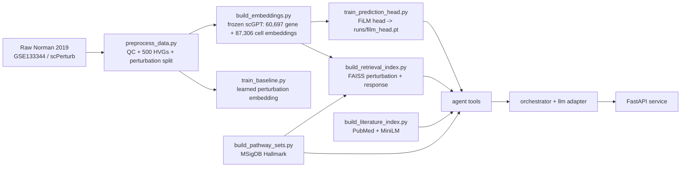

# PerturbGPT

Predicting transcriptional responses to genetic perturbation on the Norman et
al. (2019) Perturb-seq dataset, using **frozen scGPT embeddings**, a
**FiLM-conditioned prediction head**, **FAISS retrieval**, **pathway
enrichment**, **PubMed literature RAG**, and a **tool-calling agent** whose
claims are automatically checked for citation grounding.

The repository ships four progressively more capable ablation levels
(baseline → FiLM head → +retrieval → full agent), an ablation runner, a
FastAPI service, and a test suite that runs without any model weights,
network access, or cached artefacts.

> **Status:** research code. Large artefacts (`data/*`, `runs/*.pt`) are
> generated locally by the scripts below and are intentionally *not*
> committed. Run the pipeline in order to reproduce them.

---

## Results

### Prediction quality (pseudobulk Δx, 500 HVGs)

Latest rows recorded in `results/metrics.csv` (regenerate with
`python scripts/train_baseline.py` and
`python scripts/train_prediction_head.py`). Metrics are reported on the raw
delta scale; targets are **not** per-gene standardised.

| split | model | Pearson | Spearman | MSE | MAE | top-50 prec. | top-50 recall |
|---|---|---|---|---|---|---|---|
| val | baseline | 0.7226 | 0.2143 | 5.1975 | 0.5349 | 0.6160 | 0.6160 |
| val | film_head | 0.7225 | 0.2712 | 12.0767 | 0.4974 | 0.6267 | 0.6267 |
| test | baseline | 0.7916 | 0.2770 | 14.7563 | 0.8805 | 0.5925 | 0.5925 |
| test | film_head | 0.7845 | 0.2845 | 17.4213 | 0.8599 | 0.6150 | 0.6150 |

Read this honestly: Pearson/Spearman are respectable for unseen perturbations,
but MSE/MAE are large in absolute terms because a handful of strongly
responding genes dominate the raw delta scale. The FiLM head's advantage is in
ranking (top-50) and Spearman, not in calibrated magnitude.

### Retrieval (`data/indices/retrieval_results.json`)

Ground truth = MSigDB Hallmark pathway co-membership. 226 perturbations are
indexed; **133** have at least one true-positive neighbour (median 23
neighbours among those).

| system | Recall@5 | Precision@5 | MRR@5 | Recall@20 | MRR@20 |
|---|---|---|---|---|---|
| `faiss_perturbation` | **0.3429** | **0.3283** | **0.4445** | 0.2554 | 0.4470 |
| `random_baseline` | 0.0222 | 0.0222 | 0.0044 | 0.0889 | 0.0044 |
| `expr_correlation` | 0.0442 | 0.0442 | 0.1030 | 0.1025 | 0.1030 |
| `faiss_response` | 0.0372 | 0.0372 | 0.0343 | 0.1034 | 0.1442 |

**The perturbation index works** — 15× the random baseline at K=5, and it
beats ranking by raw pseudobulk correlation. The **response index is not yet
meaningful**: it was built from the plumbing checkpoint in `runs/film_head.pt`
(real architecture, untrained weights). Retrain the head and rerun
`scripts/build_retrieval_index.py --checkpoint runs/film_head.pt` to refresh
that row.

### Agent grounding

| group | grounding rate | citation validity | no-evidence fallback | tool success |
|---|---|---|---|---|
| `probes` (mock LLM + mock tools, CI) | 0.50 | 0.75 | 0.75 | — |
| `full_agent` (real tools, 3 test perts, 9 calls) | **1.00** | **1.00** | **1.00** | **1.00** |

The probe numbers are *supposed* to be below 1.0: one probe deliberately emits
an unbacked citation to prove the checker catches it.

---

## Architecture



**Prediction head.** A perturbation's embedding is the sum of its constituent
scGPT gene embeddings (single gene → that gene's embedding; combination →
element-wise sum). A FiLM generator maps it to per-layer `(gamma, beta)` pairs
that modulate a backbone driven by the control-cell embedding; the head emits
`mu` and `log_variance` per HVG and is trained with a Gaussian NLL on the
observed pseudobulk delta. At inference the control embedding used is the mean
over training control cells, stored in the checkpoint.

**Agent.** Four tools: `get_predicted_genes`, `find_similar_perturbations`,
`get_pathways`, `retrieve_literature`. The system prompt forces one
`[source: tool → detail]` citation per factual sentence, and
`perturbgpt.eval.agent_eval` verifies programmatically that every citation
names a tool that actually ran and returned evidence.

---

## Repository layout

```
src/perturbgpt/
  agent/          tools, prompts, orchestrator, pluggable LLM backends
  api/            FastAPI app + Pydantic schemas
  data/           loading, QC/normalisation, splits, builtin pathway fallback
  eval/           prediction metrics, pathway enrichment, agent-eval checks
  foundation/     frozen scGPT wrapper (+ optional Geneformer wrapper)
  models/         baseline MLP, GeneMLP / FiLM heads, checkpoint I/O
  rag/            PubMed ingest + sentence-embedding literature index
  retrieval/      FAISS indices + Recall@K / Precision@K / MRR
scripts/          one script per pipeline stage (see below)
configs/          data, model, training, W&B sweep configs
tests/            pytest suite (no weights, no network, no artefacts required)
notebooks/        data/QC, embeddings/retrieval, results figures
```

## Data

* **Dataset:** Norman et al., *Science* 2019 (`GSE133344`), harmonised by
  scPerturb (Zenodo record 7041849, CC-BY-4.0).
  K562 cells with CRISPRa overexpression of transcription factors and
  two-gene combinations.
* **After QC:** 87,306 cells × 500 HVGs, 226 perturbations + 9,687 control
  cells. Library-size normalised to 10k; **no log1p** (deltas are on the
  normalised-expression scale).
* **Split:** perturbation-level 70/15/15 (70 / 15 / 16 perturbations), so no
  perturbation identity leaks across splits; control cells live in train.
* **Genes:** 101 distinct perturbation genes; 49 of them appear in MSigDB
  Hallmark, which is what makes the retrieval ground truth non-empty for 133
  perturbations.

## Installation

Python ≥ 3.10. CPU-only PyTorch is enough for everything except scGPT
embedding extraction at scale.

```bash
# CPU wheel first (avoids ~2 GB of CUDA libraries)
pip install torch --index-url https://download.pytorch.org/whl/cpu

# core package + test/lint tooling
pip install -e ".[dev]"

# optional extras, as needed
pip install -e ".[retrieval]"     # faiss-cpu   (retrieval indices)
pip install -e ".[pathways]"      # gseapy      (MSigDB Hallmark download)
pip install -e ".[literature]"    # sentence-transformers (PubMed RAG)
pip install -e ".[api]"           # fastapi + uvicorn (HTTP service)
pip install -e ".[scgpt]"         # scGPT       (embedding extraction)
pip install -e ".[geneformer]"    # transformers (optional comparison)
```

## Reproducing the pipeline

Run from the repository root. Each step writes into `data/` or `results/`;
none of those artefacts are committed.

```bash
# 1. Data + QC + 500 HVGs + split
python scripts/download_data.py
python scripts/preprocess_data.py

# 2. Frozen scGPT embeddings (needs models/scGPT_human + the scgpt extra)
python scripts/build_embeddings.py --model-dir models/scGPT_human

# 3. Baseline + FiLM head (FiLM writes runs/film_head.pt)
python scripts/train_baseline.py
python scripts/train_prediction_head.py --checkpoint-out runs/film_head.pt

# 4. Pathway sets and retrieval indices + Recall@K/Precision@K/MRR
python scripts/build_pathway_sets.py
python scripts/build_retrieval_index.py --checkpoint runs/film_head.pt

# 5. Literature RAG (PubMed fetch is rate-limited; cached afterwards)
python scripts/build_literature_index.py

# 6. Ablations: prediction + retrieval + agent probes + real agent
python scripts/run_ablations.py --full-agent --agent-perts 3

# 7. Figure
python scripts/plot_pred_vs_true.py
```

Useful flags: `--use-wandb` on either training script; `--run-all` on
`run_ablations.py` to re-run steps 3–4 first; `--genes-from all` on
`build_literature_index.py` to index every perturbation gene instead of the
test split; `--source builtin` on `build_pathway_sets.py` for a fully offline
fallback (approximate sets, clearly tagged in the metadata sidecar).

## API

```bash
pip install -e ".[api]"
uvicorn perturbgpt.api.main:app --reload --port 8000
```

| method | path | purpose |
|---|---|---|
| GET | `/health` | liveness + which artefacts are present |
| POST | `/predict` | top-k predicted DE genes for a perturbation |
| POST | `/analyze` | run the tool-calling agent and return answer + evidence |
| POST | `/similar-perturbations` | nearest perturbations (gene or response index) |

```bash
curl -s localhost:8000/health

curl -s -X POST localhost:8000/predict \
  -H 'content-type: application/json' \
  -d '{"perturbation_id": "KLF1", "top_k": 5}'

curl -s -X POST localhost:8000/similar-perturbations \
  -H 'content-type: application/json' \
  -d '{"perturbation_id": "KLF1", "top_k": 3, "index_type": "perturbation"}'

curl -s -X POST localhost:8000/analyze \
  -H 'content-type: application/json' \
  -d '{"question": "What are the downstream effects of KLF1 perturbation?", "perturbation_id": "KLF1"}'
```

Missing artefacts return **503** with an actionable message (never a 500), so a
client can distinguish "not deployed" from "bad request"; unknown
perturbations in an index return **404**; malformed payloads return **422**.

## Agent and LLM backends

The orchestrator only needs `llm_fn(prompt: str) -> str`:

| provider | requirements | notes |
|---|---|---|
| `deterministic` (default) | none | scripted planner; calls the real tools and cites every result. Used for CI and offline demos. |
| `openai` | `OPENAI_API_KEY`, optional `OPENAI_BASE_URL` | any OpenAI-compatible `/chat/completions` endpoint (vLLM, LM Studio, …) |
| `anthropic` | `ANTHROPIC_API_KEY` | Messages API |
| `ollama` | local daemon (`OLLAMA_HOST`) | fully local models |

```bash
python scripts/run_ablations.py --full-agent --llm-provider deterministic
OPENAI_API_KEY=... python scripts/run_ablations.py --full-agent --llm-provider openai --llm-model gpt-4o-mini
```

Environment defaults: `PERTURBGPT_LLM_PROVIDER`, `PERTURBGPT_LLM_MODEL`.

### Literature RAG

PubMed abstracts are fetched with E-utilities (`NCBI_API_KEY` raises the rate
limit), stored in `data/literature/abstracts.json`, embedded with
`sentence-transformers/all-MiniLM-L6-v2` (a *general* text space, deliberately
separate from scGPT's biological space), and searched with FAISS.

The relevance threshold is `0.20`, calibrated on the bundled corpus: gibberish
queries peak at ~0.14, a bare gene symbol at ~0.19, and contextual biology
queries at ~0.30–0.45. Below the threshold the tool returns **an empty list**,
which the agent must report as "no supporting evidence" — it must never
fabricate a citation.

## Ablation suite

`scripts/run_ablations.py` prints and persists (`results/ablation_results.json`)
all four levels:

1. **baseline** — learned perturbation embedding + MLP (no cell state).
2. **film_head** — FiLM over frozen scGPT cell/gene embeddings.
3. **+retrieval** — FAISS perturbation/response indices scored against pathway
   co-membership, with random and expression-correlation baselines.
4. **full agent** — real tools on test perturbations, scored for citation
   grounding, validity, and no-evidence behaviour.

## Reproducibility notes

* **500 HVGs** are baked into `data/processed/perturbseq.h5ad` and recorded in
  `uns["preprocessing"]["n_top_hvgs"]`; `configs/data.yaml` matches. Changing
  the HVG count requires re-running preprocessing **and** the embedding step.
* **Gene embeddings cover the full scGPT vocabulary** (60,697 genes), not just
  the 500 HVGs, so the perturbation-embedding index is not restricted to HVGs.
* **Raw delta scale.** Targets are not per-gene standardised; MSE/MAE are
  therefore in normalised-expression units, and comparisons across datasets
  would need re-standardisation.
* **FiLM inference uses a stored mean control embedding** (`control_emb_mean`
  in the checkpoint) so the agent/API never need per-cell embeddings.
* **Checkpoint contract.** `runs/film_head.pt` is a plain dict:
  `arch`, `model_config`, `model_state_dict`, `gene_names`,
  `control_emb_mean` (FiLM only), `created`. Legacy gene-MLP checkpoints
  without `arch` still load (`arch` defaults to `"gene_mlp"`).
* **Artefacts are untracked.** `data/*` and `*.pt` are gitignored; the scripts
  are the source of truth, and no test depends on generated artefacts.

## Testing, linting, CI

```bash
ruff check .
pytest -q
```

The suite (225+ tests) uses synthetic AnnData, fake embedding models and
stubbed tools. It needs **no** checkpoint, index, network access, or cached
embeddings; optional-dependency tests skip cleanly when the extra is absent.
`.github/workflows/ci.yml` runs ruff + pytest on Python 3.10 and 3.11 with a
CPU PyTorch wheel.

## Docker

```bash
docker compose build
docker compose up        # http://localhost:8000/health
```

The image contains code + dependencies only. Mount artefacts read-only at
runtime (`./data:/app/data:ro`, `./runs:/app/runs:ro`, already wired in
`docker-compose.yml`) — they are hundreds of MB and change independently of
the code.

## Limitations

* **Response-index retrieval is only as good as the trained head.** Until the
  FiLM head is trained on full-scale data, `faiss_response` is near random;
  treat the perturbation index as the meaningful retrieval signal for now.
* **Literature coverage is small** (77 abstracts for the test-split genes at
  `--max-per-query 5`). Scores are noisy; the threshold is what keeps the agent
  honest, not the ranking quality.
* **Biology caveat.** The task is a *simulation* of perturbation responses on
  one cell line (K562) with CRISPRa overexpression; it does not model
  CRISPR-knockout or non-K562 contexts.
* **Agent grounding is syntactic.** Citations are validated by checking that
  the named tool actually ran in the same conversation — not by re-reading the
  abstract to confirm the claim.
* **Geneformer wrapper is experimental** and not used for the headline results.

## Attribution

* Dataset: Norman et al., *Science* 2019, doi:10.1126/science.aax4438;
  harmonised by scPerturb (Peidli et al.), Zenodo 7041849, CC-BY-4.0.
* Foundation model: scGPT (Cui et al., *Nature Methods* 2024).
* Gene sets: MSigDB Hallmark (Subramanian et al. 2005; Liberzon et al. 2015),
  retrieved via `gseapy`. Builtin fallback sets are approximate and labelled
  as such.
* Literature: NCBI E-utilities; abstracts remain under their publishers'
  terms.
